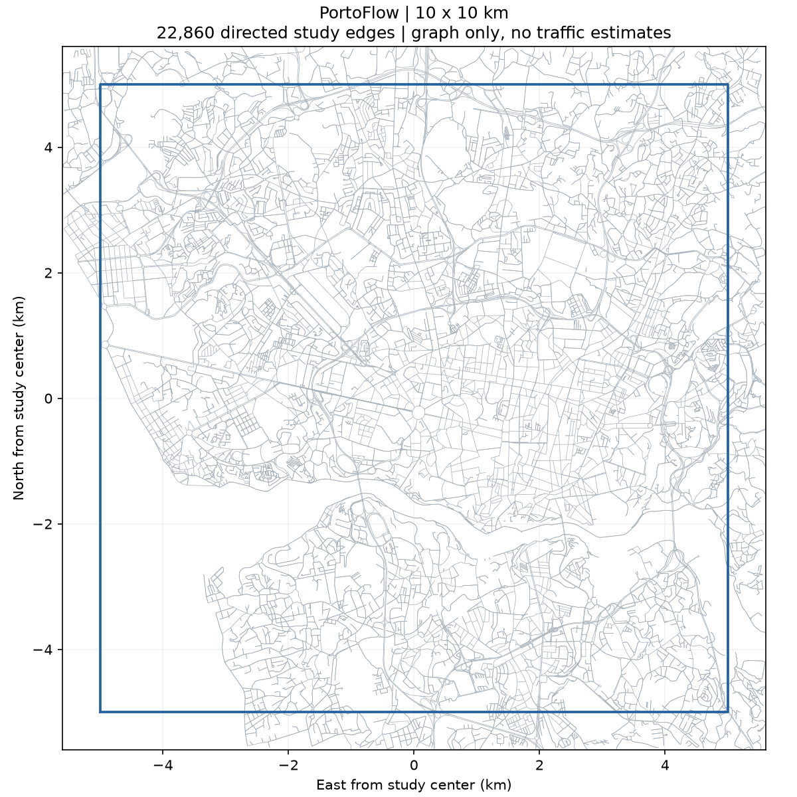

# PortoPulse

Demo **PortoFlow**: xem giao thông taxi lịch sử trong vùng Porto **10×10 km**,
chọn điểm A/B và so sánh ba cách chọn tuyến trên mạng đường ô tô có hướng.
Giao diện tiếng Việt; ứng dụng chạy cục bộ bằng Streamlit.



## Clone và chạy demo trên Windows

Cài **Git** và **Python 3.12** trước. Mở PowerShell rồi chạy:

```powershell
git clone https://github.com/ncat218/PortoPulse.git
cd PortoPulse
py -3.12 -m venv .venv
.\.venv\Scripts\python.exe -m pip install -c requirements/constraints.txt -e ".[app]"
.\.venv\Scripts\python.exe scripts\run_demo.py
```

Mở **http://localhost:8502**. Giữ PowerShell chạy; nhấn `Ctrl+C` để tắt app.
Nếu không có lệnh `py` nhưng `python --version` là3.12, dùng
`python -m venv .venv` ở bước tạo môi trường.

Repo có graph đã kiểm SHA và gói profile đã tính trên Kaggle từ dữ liệu thật.
Lần mở đầu tự ghép bản xem thử vào `runs/demo` (GeoJSON khoảng192MB), có thể
mất thêm ít thời gian và cần tối thiểu2GiB trống. Những lần sau dùng lại bản đã
kiểm hash. Demo không cần raw Porto, tài khoản Kaggle hay chạy lại matching.
Không cần cài fastmm cho việc xem app.

Nếu cổng8502 đang được dùng, chọn cổng khác:

```powershell
.\.venv\Scripts\python.exe scripts\run_demo.py --port 8503
```

Mở http://localhost:8503. Nếu đã có export riêng, chạy trực tiếp:

```powershell
.\.venv\Scripts\python.exe scripts\launch_app.py --export "DUONG_DAN_TOI_EXPORT"
```

## Chơi thử app

1. Chọn **weekday/weekend** và khung giờ **Europe/Lisbon** ở thanh bên.
2. Xem **Bản đồ giao thông**, bấm vào đường để xem tốc độ, số chuyến, taxi và ngày hỗ trợ.
3. Chuyển sang **Chọn hành trình**. Bấm **A · Điểm đi**, chọn A trên bản đồ;
   bấm/chọn tiếp B. Có đủ hai điểm, app tự tính tuyến. Có thể nhập tọa độ trong
   **Nhập tọa độ A/B**, đổi A↔B hoặc chọn lại.
4. Đổi giữa **Ngắn nhất theo quãng đường**, **Theo tốc độ trung bình** và
   **Theo khung giờ, có xét độ phủ**. Mở bảng so sánh để xem quãng đường, ETA
   và tỷ lệ quãng đường chưa xác định. Các phương án có thể trùng đường đi.

Tuyến bắt đầu/kết thúc tại vị trí chiếu của A/B trên đoạn đường gần nhất,
bao gồm phần cạnh đầu và cuối, thay vì chỉ đi đến nút giao gần nhất.
Đường một chiều được giữ đúng. Nếu chọn A/B trong tòa nhà hoặc ngoài mạng đường,
nét đứt nối tới đường chỉ là khoảng cách hình học, không phải tuyến đi bộ/ô tô
đã kiểm chứng và không được tính vào ETA.

## Đọc màu và ETA

| Màu | Ý nghĩa |
|---|---|
| Xanh lá | Di chuyển tương đối bình thường |
| Vàng | Chậm tương đối |
| Đỏ | Chậm nhiều tương đối |
| Xám | Chưa xác định, chưa đủ bằng chứng |
| Viền xanh dương | Đường đi đang chọn; màu bên trong vẫn là tình trạng cạnh theo đúng chiều xe chạy |

Hai chiều của cùng một đường có thể có màu khác nhau. Các đường trùng hình học
được tách nhẹ thành nét song song trên lớp bản đồ để nhìn được cả hai chiều;
phép tách nét chỉ dùng để hiển thị, không thay hình học dùng tính quãng đường.

ETA dùng tốc độ lịch sử, giữ khung giờ khởi hành cho toàn tuyến. Đoạn thiếu
dữ liệu dùng proxy dự phòng và được công bố trong tỷ lệ chưa xác định.
Phương án theo khung giờ phạt chi phí chọn đường trên đoạn chưa xác định;
ETA trong bảng dùng cùng một bộ ước lượng cho cả ba phương án. Đây chưa phải
thời gian thực tế đo được hoặc bằng chứng tiết kiệm thời gian ngoài đường.

## Kết quả hiện có và giới hạn

Graph cố định có **22.860 cạnh có hướng**, context matching26.254cạnh.
Profile có274.320 tổ hợp cạnh–nhóm giờ. Train đã xử lý **1.343.398/1.343.398**
chuyến đủ điều kiện; holdout xử lý **75.322/303.479**, còn228.157chuyến.
**Chưa khung giờ nào đạt80% độ phủ.**

| Giờ Lisbon | Ngày thường | Cuối tuần |
|---|---:|---:|
| 00–06 | 64,02% | 65,86% |
| 06–09 | 60,77% | 56,84% |
| 09–12 | 67,66% | 50,36% |
| 12–16 | 70,49% | 54,47% |
| 16–19 | 69,10% | 51,82% |
| 19–24 | 68,98% | 58,27% |

Trên148.312 component holdout được chấm, Kaggle báo MAE ETA56,93→51,22giây
khi dùng profile khung giờ thay tốc độ tĩnh. Review ZIP không có CSV từng
component nên chỉ số này chưa được tính lại độc lập trên máy cục bộ.

**Bản demo là candidate đang chờ kiểm QC/holdout; không phải giao thông trực tiếp.**
Các tốc độ cạnh được nội suy từ khoảng GPS15giây. Graph OSM hiện tại có thể khác
mạng đường thời kỳ dữ liệu2013–2014. Train/holdout tách nguyên chuyến;
holdout không được đưa vào profile. Giữ support3chuyến/2taxi/2ngày và ngưỡng
tỷ lệ0,7/0,4; unknown giữ xám. Chạy nốt holdout để hoàn thiện đánh giá không làm
tăng độ phủ train. [Báo cáo kiểm tra](reports/real_run_20261026/REPORT.md).

## Pipeline và khôi phục Kaggle

Xử lý raw toàn nguồn chạy trên Kaggle CPU; demo không chạy bước nặng trên laptop.

- [Notebook pipeline đầy đủ](notebooks/PortoFlow_Kaggle.ipynb)
- [Khôi phục report sau timeout](docs/REPORT_RECOVERY.md)
- [Tiếp tục ledger sau lỗi dung lượng](docs/REPORT_CONTINUE.md)
- [Thiết kế pipeline](docs/PIPELINE.md) · [Tiến độ](STATUS.md)

Để xây gói code cho notebook từ repo:

```powershell
.\.venv\Scripts\python.exe scripts\build_kaggle.py
```

Để chạy kiểm thử, cài thêm test (và fastmm nếu muốn chạy native synthetic E2E):

```powershell
.\.venv\Scripts\python.exe -m pip install -c requirements/constraints.txt -e ".[app,test,fastmm]"
.\.venv\Scripts\python.exe scripts\build_kaggle.py
.\.venv\Scripts\python.exe scripts\build_report_recovery.py
.\.venv\Scripts\python.exe scripts\build_report_continue.py
.\.venv\Scripts\python.exe -m pytest -q
```

Các fixture kiểm thử được ghi nhãn SYNTHETIC, tách biệt với kết quả Kaggle thật.
Không có lịch cập nhật tự động hằng ngày; cập nhật sau mốc hữu ích hoặc khi cần.

Nguồn GPS: [UCI Taxi Service Trajectory Prediction](https://archive.ics.uci.edu/dataset/339/taxi+service+trajectory+prediction+challenge+ecml+pkdd+2015)
và [Kaggle Porto](https://www.kaggle.com/competitions/pkdd-15-predict-taxi-service-trajectory-i/data).
Graph ©[OpenStreetMap contributors](https://www.openstreetmap.org/copyright), ODbL.
Repo không chứa raw GPS, ledger13GB hoặc toàn bộ matching checkpoints.
